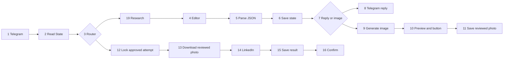

# LinkedIn Content Automation

Create and review AI-assisted LinkedIn posts through a Telegram conversation. Make connects web research, drafting, natural-language revisions, image generation, approval, and publishing.


## What is included

This repository contains **one 17-module Make scenario** for the on-demand workflow:

1. Send a message to the Telegram bot.
2. Research recent AI or technology developments when the request needs current information.
3. Suggest topics, write a draft, or revise it using the conversation context.
4. Generate an image when requested and show a Telegram preview.
5. Publish the reviewed text and image after the owner presses **Publish reviewed post**.

The editor preserves the current draft when answering questions. A text revision invalidates the previous image review. The image published on LinkedIn is downloaded from the Telegram preview, so it uses the reviewed photo.

**Human approval is required before publishing.** In this exported workflow, requesting text and an image together produces the text first. Review the draft, then request its image. The image node creates a new picture from a text description; it does not receive the previous image as an editing input.

### Weekly companion flow

The broader project also has a weekly routine: Telegram topic suggestions, topic selection, content preparation, review, and publishing after approval. **That companion scenario is not included in the supplied export or this repository.** This blueprint does not send weekly notifications by itself. Its export and schedule settings must be added separately to reproduce that part of the project.

## Technology

| Component | Responsibility |
|---|---|
| Make.com | Scenario routing, filters, app connections, and execution |
| OpenAI Responses | Research using the Web search preview tool |
| OpenAI chat completion | Topic ideas, drafting, edits, image descriptions, and short conversation memory |
| OpenAI image generation | Illustration generation |
| Telegram Bot API | Messages, photo previews, approval callbacks, and reviewed-photo download |
| Google Sheets | Owner configuration and one active draft's state |
| LinkedIn integration | Image-post publishing to the connected personal profile |

The export retains the source project's selected models: `gpt-6-luna` for research/editing and `gpt-image-2` for images. Account access and model availability must be checked during setup. OpenAI API usage and web search may incur provider charges; Make operations consume account credits. This workflow uses the OpenAI app's search tool, not the separate Make AI Web Search app.

## Repository files

```text
blueprints/LinkedIn_Content_Automation.blueprint.json
prompts/
  editor-system.txt
  editor-user-template.txt
  research-instructions.txt
  research-input-template.txt
docs/
  state-sheet.md
  validation.md
  export-validation.json
assets/
  linkedin-project-cover.png
  cover-image-prompt.txt
tools/
  prepare_public_export.py
README.md
```

The blueprint is the automation source to import into Make. Python is only an optional local export-preparation helper; there are no Python or code modules running inside this scenario. The prompt text files mirror the corresponding blueprint fields.

## Setup

### 1. Prepare accounts and the state sheet

Use a Telegram bot, an OpenAI API account, a Google account with Google Sheets, and the LinkedIn profile that will own the posts. Keep API keys and OAuth authorization in Make connections.

Create a Google Sheet using the [State sheet specification](docs/state-sheet.md). Its tab must be named **State**, with headings in row 1 and the owner record in row 2. Fill in your private Telegram chat ID and user ID. Start with `publishing_enabled` set to the lowercase text `false`.

### 2. Import the blueprint

Create a new Make scenario and import `blueprints/LinkedIn_Content_Automation.blueprint.json`. Account connections and the Telegram webhook are intentionally unbound.

Configure these module IDs:

| Modules | Setup |
|---|---|
| 1 | Create/select the Telegram webhook for this bot. Include messages and callback queries if update types are configurable. |
| 2 | Select a Google connection and your native Google Sheet. Keep tab State, headers enabled, filter A equals owner, and limit 1. |
| 6, 11, 12, 15 | Select the same Google connection. Preserve mapped spreadsheet IDs, row 2, tab State, RAW input, and existing cell mappings. |
| 4, 9, 19 | Select your OpenAI connection. Confirm the selected models are available. |
| 8, 10, 13, 16 | Select the connection for the same Telegram bot. |
| 14 | Select the LinkedIn connection for the intended personal profile. |

Keep **Sequential processing ON** and **Store incomplete executions OFF**. Use one active webhook consumer for the Telegram bot and one scenario writing this state row. A duplicate active scenario or manual replay can bypass the intended state sequence.

### 3. Check the two paths



The owner filter runs before research. Research uses Tool Choice **Auto**: each accepted text message invokes module 19, but web search is optional. Ordinary editing requests should not need a new search. Auto is not proof that a particular news request actually searched.

## Try it

Keep publishing disabled while testing:

> Find three recent AI announcements with their dates and original source links.

> Write a post about the second one.

> Make the opening shorter and less formal.

> Generate a simple professional image for this post, without text or logos.

These are examples, not required commands. Review the source links, draft, and image. The sheet should reach status `ready` after a preview is saved. A preview button while publishing is disabled does not create a post.

When ready for a real public post, wait until the current execution finishes, set D2 (`publishing_enabled`) to the lowercase text `true`, and press **Publish reviewed post** under the latest photo. Confirm the post on the connected LinkedIn profile and check the saved result. Return D2 to `false` when publishing should be disabled.

## State and failure handling

The sheet is one current-state record, not a post archive. Chat memory is a short AI-written summary, not a full transcript. A new draft replaces the previous one. Leaving the conversation does not publish the saved draft automatically.

Module 12 writes `publishing` and takes a lock before external publishing work. That status means **attempt started**, not confirmed success. The workflow records `published` only after a returned post ID and successful state update. A second click is gated using the current button token, preview message, draft/image versions, and state lock.

If publishing stops, inspect Make History > Details and check modules 13–15. Check the connected LinkedIn profile before any retry: a failed response or failed result save can occur after the external action succeeded. Do not blindly clear the lock or replay the create-post module. Reconcile a confirmed existing post in the sheet; release a failed attempt only after confirming that no post was created and no publishing execution remains in progress.

This is a guard inside a sequential scenario, not an atomic transaction or an exactly-once publishing guarantee.

## Important mappings and limits

- Module 13's actual downloaded binary output is `fileOutput`, displayed as **Data** in Make. Module 14 maps `{{13.fileOutput}}` into File > Data and `{{13.fileName}}` into File > File Name. Its input filter checks whether `fileOutput` exists.
- Module 5 parses the editor's first completion: `{{get(4.choices; "1.message.content")}}`.
- The editor reads research answer text using `{{first(map(19.output; "content.1.text"; "type"; "message"))}}`, avoiding the assumption that the first output item is a message.
- The editor returns exactly five string fields: `action`, `reply`, `draft_text`, `image_prompt`, and `memory`.
- Reply limits are 3500 characters for chat and 1200 for draft/image actions. Drafts are limited to 2800, image descriptions to 1500, and conversation memory to 1500. These are checked by filters; an AI response outside the bounds can stop without an external-service error. Prompt instructions alone do not guarantee character counts.
- Module 15 and the confirmation message expect the LinkedIn post ID in `14.id`. Verify that output on the first live publication. If the account's native module returns another field, update the filter, saved ID/link, and confirmation together after reconciling the attempt.

## Validation and scope

See [validation notes](docs/validation.md). The public copy was checked locally for expected routing, account-resource removal, and the corrected image mapping. It was not imported into Make or live-tested against accounts during release preparation. Earlier fixture tests for the old 16-module project do not certify this 17-module export.

The image-generation cover is an illustrative project asset, not a screenshot of Make or evidence of execution. This project is an independent integration and is not endorsed by the service providers.
